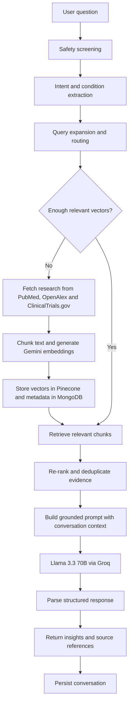

# Curalink

### AI-powered medical research discovery, grounded in published evidence.

Curalink is a full-stack research assistant that helps users explore medical literature and clinical-trial information through a conversational interface. It retrieves material from **PubMed**, **OpenAlex**, and **ClinicalTrials.gov**, indexes research in a vector database, and uses retrieval-augmented generation (RAG) to produce structured, source-linked responses.

Curalink is designed for **research discovery and education**. It is not a medical device and does not provide diagnosis, treatment, or personalized medical advice.

---

## What you can do with Curalink

- **Ask research questions in natural language.** Explore conditions, therapies, mechanisms, recent findings, researchers, and clinical trials through multi-turn chat.
- **Search multiple evidence sources.** Retrieve publication records from PubMed and OpenAlex, and study records from ClinicalTrials.gov.
- **Get context-aware answers.** Query understanding, conversation history, vector retrieval, and source-aware ranking help keep responses relevant to the question.
- **Inspect supporting sources.** Review research cards, source links, abstracts, clinical-trial details, and trial status where available.
- **Add your own PDFs.** Upload PDF research documents for text extraction, chunking, embedding, and retrieval alongside indexed research.
- **Use a personalized workspace.** Sign in with email/password or Google OAuth, keep conversation history, save chats, and set a preferred audience level and response style.
- **Switch between light and dark themes.** The interface remembers the selected theme.
- **Use voice interaction.** Browser speech recognition and speech synthesis enable spoken input and read-aloud responses in supported browsers.
- **Explore research trends.** View publication-year trends when trend data is included in a response.

---

## How it works

A typical research question moves through the following pipeline:



### Retrieval and ranking

1. The backend checks the incoming question with a keyword-based safety layer.
2. It extracts the likely condition, research intent, and timeframe, then expands the search query.
3. It checks Pinecone for relevant content. When the configured relevance threshold is not met, it attempts a live fetch from the research providers.
4. Retrieved text is embedded with Google's Gemini embedding model and searched in Pinecone.
5. Candidate chunks are ranked using a composite score:

   `ranking score = 0.50 × relevance + 0.30 × recency + 0.20 × source credibility`

6. The best evidence is deduplicated and passed to Llama 3.3 70B through Groq, together with recent conversation context.
7. The backend parses the model output into structured fields for the frontend and stores the conversation in MongoDB.

The current source credibility weights are PubMed **1.00**, OpenAlex **0.85**, ClinicalTrials.gov **0.75**, and uploaded PDFs **0.60**. Ranking is a retrieval heuristic—not a formal assessment of study quality or clinical evidence certainty.

### Research ingestion

Research records are normalized, split into sentence-aware chunks with overlap, embedded, and indexed in Pinecone. MongoDB stores the associated paper or trial metadata. Uploaded PDFs use a separate document-ingestion pipeline and are also indexed for retrieval.

---

## Technology stack

| Area | Technologies |
|---|---|
| Frontend | React 19, Vite 8, React Router, Zustand, React Context, Axios, CSS Modules, Recharts |
| Backend | Node.js, Express 5 |
| LLM | Llama 3.3 70B through Groq's OpenAI-compatible API |
| Embeddings | Google Gemini Embeddings (`gemini-embedding-001` in the supplied environment template) |
| Vector database | Pinecone — 768-dimensional vectors, cosine similarity |
| Metadata and conversations | MongoDB Atlas with Mongoose |
| Research providers | PubMed / NCBI, OpenAlex, ClinicalTrials.gov |
| Authentication | JWT, bcrypt, Passport, Google OAuth 2.0 |
| File processing | Multer, `pdf-parse` |
| Voice | Browser Speech Recognition and Speech Synthesis APIs |

---

## Repository layout

The supplied code is split into two applications. For a combined repository, place the extracted projects in this layout:

```text
curalink/
├── backend/
│   ├── server.js
│   ├── .env.example
│   ├── scripts/
│   └── src/
│       ├── config/
│       ├── controllers/
│       ├── middleware/
│       ├── models/
│       ├── pipelines/
│       ├── routes/
│       ├── services/
│       └── utils/
├── frontend/
│   ├── index.html
│   ├── package.json
│   ├── SYSTEM_DOCUMENTATION.md
│   └── src/
│       ├── components/
│       ├── context/
│       ├── hooks/
│       ├── pages/
│       ├── services/
│       ├── store/
│       └── utils/
└── README.md
```

If you keep the frontend and backend in separate GitHub repositories, use the relevant sections below in each repository's README or adapt the paths accordingly.

---

## Getting started

### Prerequisites

- **Node.js 20.19+** (or 22.12+) and npm. Vite 8 in the frontend requires this Node.js range.
- A MongoDB database (MongoDB Atlas works well).
- A Pinecone project and an index configured for **768 dimensions** with the **cosine** metric.
- A Google AI Studio API key for embeddings.
- A Groq API key for Llama chat completions.
- Optional: Google OAuth credentials for Google sign-in.

### 1. Configure the backend

```bash
cd backend
npm install
cp .env.example .env
```

Open `backend/.env` and set the required values:

```dotenv
PORT=3000
NODE_ENV=development

MONGODB_URI=mongodb+srv://<username>:<password>@<cluster-host>/<database>
MONGODB_DB_NAME=health_copilot

PINECONE_API_KEY=<your-pinecone-api-key>
PINECONE_INDEX_NAME=health-copilot
PINECONE_TOP_K=30

GEMINI_API_KEY=<your-google-ai-studio-api-key>
GEMINI_EMBEDDING_MODEL=gemini-embedding-001

GROQ_API_KEY=<your-groq-api-key>
GROQ_MODEL=llama-3.3-70b-versatile

JWT_SECRET=<a-long-random-secret>
JWT_EXPIRES_IN=7d

FRONTEND_URL=http://localhost:5173
```

Create the Pinecone index before starting the app. Its dimension must match the embedding output (**768**) and its similarity metric must be **cosine**. The index name in Pinecone must match `PINECONE_INDEX_NAME`.

The following integrations are optional:

```dotenv
# Google sign-in
GOOGLE_CLIENT_ID=<your-google-oauth-client-id>
GOOGLE_CLIENT_SECRET=<your-google-oauth-client-secret>
GOOGLE_CALLBACK_URL=http://localhost:3000/api/auth/google/callback

# Provider identification / higher provider quotas where applicable
OPENALEX_EMAIL=<your-contact-email>
PUBMED_API_KEY=<optional-ncbi-api-key>
```

The supplied `backend/.env.example` includes additional tuning options for upload size, chunk size and overlap, retrieval thresholds, rate limiting, logging, and conversation context. Keep the API keys and JWT secret private; never commit `.env`.

Start the API:

```bash
npm run dev
```

The backend listens on `http://localhost:3000` by default. Check its health endpoint at `http://localhost:3000/api/health`.

### 2. Configure the frontend

In a second terminal:

```bash
cd frontend
npm install
```

Create `frontend/.env`:

```dotenv
VITE_API_URL=http://localhost:3000/api
VITE_MAX_PDF_MB=20
```

Start the Vite development server:

```bash
npm run dev
```

Open the local URL printed by Vite (normally `http://localhost:5173`). The frontend's API client uses `VITE_API_URL`; the backend's `FRONTEND_URL` must match the frontend origin for CORS and OAuth redirects.

### 3. Optional: preload demo research

The backend includes a script that preloads example research queries across PubMed, OpenAlex, and ClinicalTrials.gov:

```bash
cd backend
npm run preload-demo
```

This is optional. It makes live provider requests, generates embeddings, and writes to MongoDB and Pinecone. It can take a few minutes and is subject to provider rate limits and API availability.

---

## Environment variables

| Variable | Purpose | Required? |
|---|---|---|
| `MONGODB_URI` | MongoDB connection string | Yes |
| `MONGODB_DB_NAME` | Database name | No — defaults to `health_copilot` |
| `PINECONE_API_KEY` | Pinecone authentication | Yes |
| `PINECONE_INDEX_NAME` | Existing 768-dimension cosine index | Yes for retrieval |
| `GEMINI_API_KEY` | Gemini embedding API access | Yes |
| `GEMINI_EMBEDDING_MODEL` | Embedding model identifier | No — see `.env.example` |
| `GROQ_API_KEY` | Groq chat completion access | Yes |
| `GROQ_MODEL` | Groq model identifier | No — defaults to `llama-3.3-70b-versatile` |
| `JWT_SECRET` | Signs authentication tokens | Yes for secure auth |
| `JWT_EXPIRES_IN` | JWT lifetime | No — defaults to `7d` |
| `FRONTEND_URL` | Allowed frontend origin and OAuth redirect destination | Recommended |
| `GOOGLE_CLIENT_ID` | Google OAuth client ID | Only for Google sign-in |
| `GOOGLE_CLIENT_SECRET` | Google OAuth client secret | Only for Google sign-in |
| `GOOGLE_CALLBACK_URL` | OAuth callback URL registered with Google | Only for Google sign-in |
| `OPENALEX_EMAIL` | Contact email for OpenAlex requests | Recommended |
| `PUBMED_API_KEY` | Optional NCBI API key | No |
| `UPLOAD_MAX_FILE_SIZE_MB` | Maximum PDF upload size | No — defaults to `20` |
| `VITE_API_URL` | Frontend API base URL | No — defaults to `http://localhost:3000/api` |
| `VITE_MAX_PDF_MB` | PDF size hint shown in the frontend | No — defaults to `20` |

---

## API overview

All backend routes are prefixed with `/api`.

| Method | Endpoint | Description |
|---|---|---|
| `GET` | `/health` | API, MongoDB, and Pinecone status |
| `POST` | `/auth/signup` | Create an account with name, email, and password |
| `POST` | `/auth/login` | Sign in with email and password |
| `GET` | `/auth/me` | Get the current authenticated user |
| `PATCH` | `/auth/me` | Update profile and response preferences |
| `GET` | `/auth/google` | Start Google OAuth (when configured) |
| `GET` | `/auth/google/callback` | Handle Google OAuth callback |
| `POST` | `/ask` | Run the research RAG pipeline |
| `GET` | `/conversations` | List the authenticated user's conversations |
| `GET` | `/conversations/:sessionId` | Retrieve a conversation by session ID |
| `DELETE` | `/conversations/:sessionId` | Delete an authenticated user's conversation |
| `POST` | `/research/ingest` | Fetch and index research for a query |
| `GET` | `/research/papers` | List ingested papers and trials |
| `GET` | `/research/stats` | Research and model/index statistics |
| `POST` | `/upload` | Upload and index a PDF (`multipart/form-data`, field: `file`) |
| `GET` | `/documents` | List uploaded document metadata |
| `DELETE` | `/documents/:documentId` | Remove a document and its indexed vectors |

### Ask a research question

`POST /api/ask`

```json
{
  "query": "What recent research explores immunotherapy for lung cancer?",
  "sessionId": "optional-session-id",
  "source": "pubmed",
  "audienceLevel": "researcher",
  "preferredTone": "clinical"
}
```

The `source` filter can be omitted to search across the available indexed sources. Supported source values include `pubmed`, `openalex`, `clinicaltrials`, and `pdf` (the frontend labels the PDF option as **Uploaded PDFs**).

A successful response is returned in the standard `{ "success": true, "data": ... }` envelope. The data includes a session ID and structured research fields such as a condition overview, research insights, clinical trials, experts, sources, and applicable disclaimers. Exact fields can vary with the retrieved evidence and parsed model response.

### Ingest research directly

`POST /api/research/ingest`

```json
{
  "query": "type 2 diabetes",
  "sources": ["pubmed", "openalex", "clinicaltrials"],
  "maxPerSource": 10
}
```

### Upload a PDF

Send a `multipart/form-data` request to `POST /api/upload` with a file field named `file`. The backend accepts PDF files only and enforces the configured maximum file size.

---

## Frontend experience

The frontend is organized around a chat workspace:

- `/chat` — start a new conversation.
- `/chat/:sessionId` — reopen a conversation.
- `/login` and `/register` — open the authentication flow.
- `/auth/callback` — complete Google OAuth sign-in.

The UI uses React Context for authentication, chat, theme, and notifications, and Zustand for conversation-list state. Axios attaches the JWT to API requests and handles expired sessions. The interface supports guest chat as well as authenticated accounts.

For a deeper frontend walkthrough, see [`frontend/SYSTEM_DOCUMENTATION.md`](frontend/SYSTEM_DOCUMENTATION.md).

---

## Safety, privacy, and responsible use

Curalink is an educational research-discovery tool, not a substitute for a qualified clinician, clinical decision-support system, or emergency service.

- The backend contains a **keyword-based safety screen** for selected emergency, diagnosis, prescription, and sensitive-topic phrases. Some emergency and diagnosis requests are blocked; other flagged topics receive disclaimers. This is a basic heuristic and is not comprehensive or clinically validated.
- Generated summaries can be incomplete, outdated, or incorrect. Always open and evaluate the original source, study design, population, limitations, and publication date before drawing conclusions.
- Trial records can change. Confirm current recruitment status, eligibility, locations, and contacts on the official ClinicalTrials.gov record.
- Do not use Curalink to make diagnosis or treatment decisions. Seek professional medical care for personal health concerns and emergency assistance for urgent situations.
- Do not upload identifiable patient information or protected health information unless you have independently completed the required privacy, security, legal, and compliance review for your deployment and service providers.
- Keep secrets server-side. Never expose MongoDB, Pinecone, Gemini, or Groq credentials in frontend code or public repositories.

---

## Deployment notes

Deploy the frontend and backend as separate services or deploy the combined repository with separate build/start configurations.

**Backend**

- Set all production secrets in the hosting provider's environment-variable settings.
- Set `NODE_ENV=production`, a strong `JWT_SECRET`, the production `FRONTEND_URL`, and the production OAuth callback URL if Google sign-in is enabled.
- Review the allowlist in `backend/src/app.js` before production. It always includes local development origins (`localhost:5174` and `localhost:5175`) in addition to `FRONTEND_URL`; remove entries that are not needed.
- Ensure MongoDB and Pinecone are reachable from the deployed service.
- Persist no secrets in source control; the `.env` file should remain untracked.

**Frontend**

- Set `VITE_API_URL` to the deployed backend API base URL, including `/api`.
- Set `VITE_MAX_PDF_MB` to match the backend's upload limit for a consistent UI hint.
- Build with `npm run build`; preview the production bundle locally with `npm run preview`.

Useful frontend commands:

```bash
npm run dev       # Start development server
npm run build     # Create production build
npm run preview   # Preview production build
npm run lint      # Run ESLint
```

Useful backend commands:

```bash
npm run dev           # Start with nodemon
npm start             # Start the production server
npm run preload-demo  # Preload the example research queries
```

---

## Current implementation notes

- The frontend's saved/pinned conversation IDs are persisted in browser `localStorage`.
- Conversation renaming currently changes the frontend label only; there is no backend rename endpoint in this version.
- Voice input/output depends on browser support for the Web Speech APIs. The current speech-recognition configuration uses English (`en-US`).
- Live research retrieval and indexing depend on the availability and rate limits of external providers and the configured AI/vector services.
- The backend package does not currently define a dedicated `npm test` script.

---

## Acknowledgements and data providers

Curalink builds on publicly accessible research metadata and APIs:

- [PubMed / NCBI](https://pubmed.ncbi.nlm.nih.gov/)
- [OpenAlex](https://openalex.org/)
- [ClinicalTrials.gov API](https://clinicaltrials.gov/data-api/about-api)
- [Google Gemini API](https://ai.google.dev/gemini-api/docs)
- [Groq](https://console.groq.com/docs)
- [Pinecone](https://docs.pinecone.io/)

Research records remain attributable to their original providers. Please review and comply with each provider's terms, rate limits, and attribution requirements.
