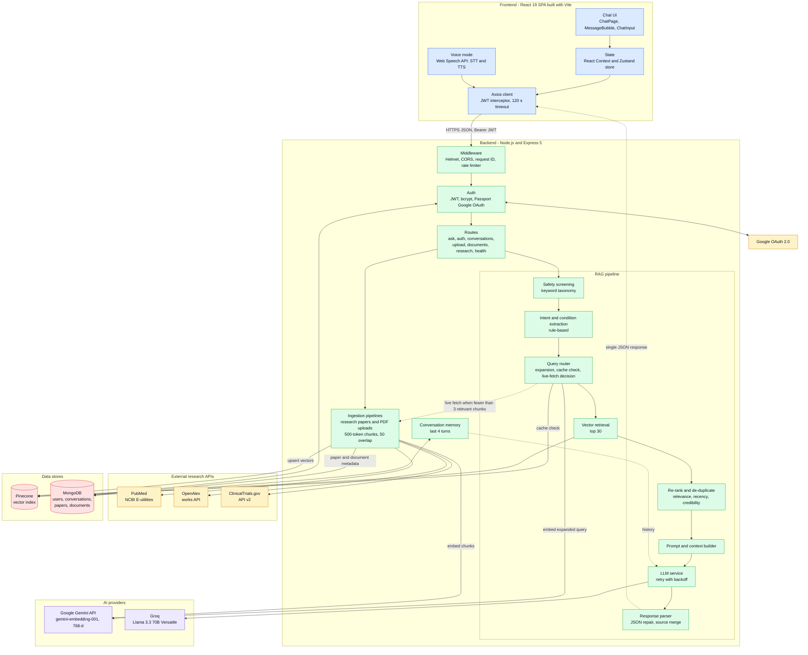
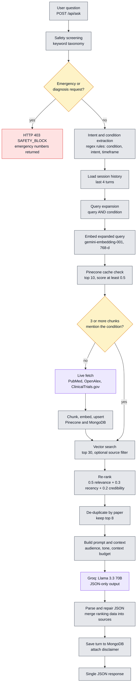
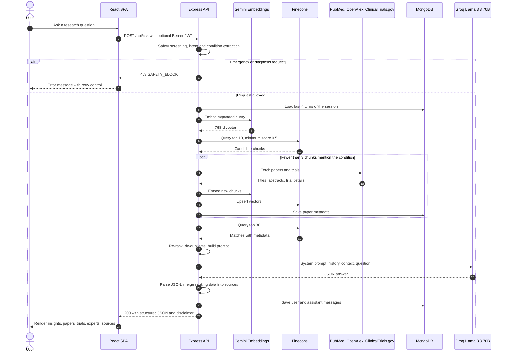
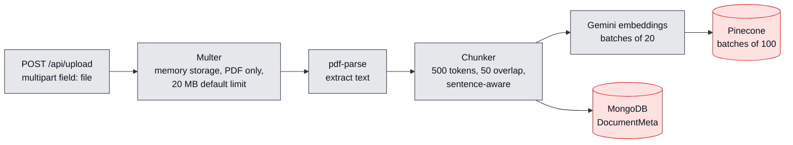

<div align="center">

# Curalink

**A source-grounded medical research assistant. It retrieves evidence from PubMed, OpenAlex and ClinicalTrials.gov, re-ranks it, and answers with structured, cited output.**

<p>
  
  
  
  
</p>
<p>
  
  
  
  
</p>
<p>
  
  
  
  
  
</p>

<a href="#system-architecture">Architecture</a> ·
<a href="#rag-pipeline-in-detail">RAG Pipeline</a> ·
<a href="#getting-started">Local Setup</a> ·
<a href="#api-reference">API Reference</a> ·
<a href="#security-and-responsible-ai">Security</a>

</div>

---

> [!IMPORTANT]
> Curalink is a **research assistance tool**. It is not a medical device and does not provide diagnosis, treatment advice or clinical decision support. Its output summarizes retrieved literature and may be incomplete or wrong. Always consult a qualified healthcare professional.

Curalink is a full-stack retrieval-augmented generation (RAG) application for exploring medical literature. A user asks a question in natural language, optionally adding a condition, patient name and location. The backend screens the request for safety, extracts the condition and intent, checks a Pinecone vector index for relevant evidence, and **fetches fresh papers and trials from PubMed, OpenAlex and ClinicalTrials.gov when the index does not cover the topic**. Retrieved chunks are re-ranked by relevance, recency and source credibility, assembled into a bounded context, and sent to Llama 3.3 70B (via Groq), which returns structured JSON. The React frontend renders that JSON as research insights, paper cards, clinical-trial cards with eligibility, locations and contacts, key researchers, and a ranked source list.

It is built for people who need to *find and read* primary sources faster: patients and caregivers preparing questions for their doctor, clinicians scanning recent literature, and researchers surveying a topic. What distinguishes the approach is that every answer is tied to retrieved records with visible ranking data, the evidence base grows on demand rather than being a fixed snapshot, and a safety layer sits in front of the model.

---

## Table of Contents

- [Why Curalink](#why-curalink)
- [Core Features](#core-features)
- [System Architecture](#system-architecture)
- [RAG Pipeline in Detail](#rag-pipeline-in-detail)
- [Technology Stack](#technology-stack)
- [Repositories and Project Structure](#repositories-and-project-structure)
- [Getting Started](#getting-started)
- [Environment Variables](#environment-variables)
- [API Reference](#api-reference)
- [Research Retrieval and Data Sources](#research-retrieval-and-data-sources)
- [Security and Responsible AI](#security-and-responsible-ai)
- [Deployment](#deployment)
- [Status, Limitations and Roadmap](#status-limitations-and-roadmap)
- [Contributing](#contributing)
- [License and Acknowledgements](#license-and-acknowledgements)

---

## Why Curalink

Medical evidence is scattered across systems that were not designed to be searched together. Journal literature lives in PubMed and OpenAlex, interventional studies live in ClinicalTrials.gov, and each has its own query model, metadata and level of detail. Anyone trying to answer "what is the latest on X?" has to query several sites, skim hundreds of abstracts, and work out which results matter.

| Problem | How Curalink addresses it |
|---|---|
| **Fragmented research information** | One query fans out to PubMed, OpenAlex and ClinicalTrials.gov, and results are normalized into a single record shape. |
| **Hard-to-discover scholarly literature** | Abstracts are embedded and searched semantically in a vector index rather than by keyword alone. |
| **Clinical trials are hard to locate** | Trial status, phase, eligibility excerpt, up to five locations and up to two central contacts are retrieved and shown on dedicated cards. |
| **Information overload** | Results are re-ranked (relevance 50%, recency 30%, source credibility 20%), de-duplicated per paper, and cut to the top 8 before generation. |
| **Need for traceable answers** | The model is instructed to answer only from retrieved context and list its sources. Each source card can show a "Why ranked" score breakdown. |

Curalink makes **no claim of clinical validation**. It speeds up reading; it does not replace it.

---

## Core Features

Every item below was verified in the source code. Paths are relative to the repository named in the second column.

| Feature | Repo | What it does and how it works |
|---|---|---|
| **Retrieval-augmented answers** | backend | `rag.pipeline.js` orchestrates safety, intent, routing, retrieval, re-ranking, prompting and parsing. The LLM is told to answer only from the supplied context and to return JSON in a fixed schema. |
| **Multi-source research retrieval** | backend | Separate services for PubMed (E-utilities), OpenAlex (works API) and ClinicalTrials.gov (API v2) normalize results into `{paperId, title, abstract, authors, year, source, url}` plus trial-specific fields. |
| **Live-fetch fallback** | backend | `queryRouter.service.js` embeds the query, checks Pinecone, and if fewer than 3 returned chunks mention the condition it ingests fresh records from all three sources before searching. |
| **Semantic search** | backend | Gemini `gemini-embedding-001` (768 dimensions) embeddings stored in Pinecone; query-time search returns the top 30 chunks with metadata. |
| **Composite re-ranking** | backend | `reranker.service.js`: `0.5 × relevance + 0.3 × recency + 0.2 × credibility`, with per-source credibility weights (PubMed 1.0, OpenAlex 0.85, ClinicalTrials.gov 0.75, PDF 0.6). |
| **Intent and condition extraction** | backend | `intent.service.js` uses regular-expression rules (no LLM call) to derive the condition, intent (e.g. `treatment`, `clinical_trials`, `researchers`) and timeframe. |
| **Query expansion** | backend | The query is combined with the condition as `query AND condition` unless the condition is already in the text. This is string concatenation, not LLM-based rewriting. |
| **Context-aware conversations** | backend | The last 4 turns of a session are sent to the model. If the new query has no recognizable condition, the condition is recovered from earlier turns. |
| **Source-backed structured output** | backend + frontend | The model returns `conditionOverview`, `researchInsights`, `clinicalTrials`, `experts` and `sources`. The backend merges ranking data into each source; the UI renders each section. |
| **Safety screening and disclaimers** | backend | A keyword taxonomy blocks emergency and personal-diagnosis requests with HTTP 403 and attaches a disclaimer to every response. |
| **PDF ingestion** | both | Users upload PDFs (max 20 MB by default). The backend extracts text with `pdf-parse`, chunks it, embeds it and upserts it to Pinecone. |
| **Structured query mode** | frontend | Optional *Disease*, *Patient Name* and *Location* fields are sent with the query. Patient name and location are passed to the model as prompt context. |
| **Authentication** | both | Email/password (bcrypt, cost 12) and optional Google OAuth 2.0, both issuing a JWT (default 7 days). Chat also works for guests. |
| **Conversation history** | both | Signed-in users get a sidebar of past sessions grouped by date, with search, delete (server-side), and rename/save (local to the browser). |
| **Voice mode** | frontend | Browser Web Speech API for speech-to-text and text-to-speech (`en-US`), backed by the same `/api/ask` endpoint. |
| **Responsive UI and theming** | frontend | Light and dark themes via CSS custom properties, a mobile drawer sidebar at ≤ 768 px, error boundaries, toasts, a retry button, and one automatic retry on network or 5xx failures. |

> [!NOTE]
> The frontend also contains UI for a research-trend chart, "key takeaways", "questions for your doctor" and a trial-eligibility summary. The current backend does not produce those fields, so these sections do not appear today. They are listed under [limitations](#status-limitations-and-roadmap).

---

## System Architecture

The system is two separately deployable applications: a React single-page app and an Express API. The API owns all AI, retrieval and persistence logic.



**Notes on the diagram**

- The response is a single JSON payload. There is **no token streaming** (no SSE or WebSocket) in either repository.
- `GEMINI_API_KEY` is used only for embeddings. Text generation goes to Groq through its OpenAI-compatible endpoint.
- MongoDB holds relational-style data (users, sessions, paper and document metadata). Pinecone holds the vectors plus chunk text and metadata.

---

## RAG Pipeline in Detail

### Flow



### Step by step

| # | Stage | What actually happens | Source |
|---|---|---|---|
| 1 | **Query ingestion** | `POST /api/ask` accepts `query`, or `additionalQuery`, or `disease`. If none is present the API returns 400. The route uses optional JWT auth. | `ask.controller.js` |
| 2 | **Safety screening** | Case-insensitive substring match against four keyword groups. `emergency` and `diagnosis` matches abort with 403. Other matches continue and only change the disclaimer text. | `safety.service.js` |
| 3 | **Intent and condition extraction** | Regex rules pick an intent (`clinical_trials`, `researchers`, `treatment`, `content_generation`, `format_conversion`, `research`, `medical_query`, `general`), a timeframe (`latest`, `recent`, `historical`) and one condition from a fixed list of 76 terms. An explicit `disease` field overrides the extracted condition. | `intent.service.js` |
| 4 | **Conversation context** | Loads up to `MAX_CONVERSATION_HISTORY × 2` messages (default 8). If no condition was found, scans earlier messages newest-first to recover one. | `rag.pipeline.js`, `conversation.service.js` |
| 5 | **Query expansion and routing** | Builds `query AND condition` (skipped if the condition is already in the query), embeds it, and queries Pinecone for 10 chunks with score ≥ `MIN_RETRIEVAL_SCORE` (0.5). Counts chunks whose title or text contains the condition. | `queryRouter.service.js` |
| 6 | **Research-source routing** | If that count is below `FRESH_FETCH_THRESHOLD` (3), runs the research ingestion pipeline against PubMed, OpenAlex and ClinicalTrials.gov (up to `MAX_PAPERS_PER_SOURCE` each, default 50). Errors are logged and swallowed, and the request continues with whatever is already indexed. | `queryRouter.service.js`, `research.ingestion.pipeline.js` |
| 7 | **Embedding generation** | Gemini embeddings with `outputDimensionality: 768`. Batches of 20 run concurrently. Retries up to 3 times on 429, 500, 502 or 503 with exponential backoff (5 s base, 30 s cap). | `embedding.service.js` |
| 8 | **Vector retrieval** | Pinecone query with `topK: 30` and no score floor. If the request carries a source filter, a metadata filter `source == <value>` is applied. | `retrieval.service.js`, `rag.pipeline.js` |
| 9 | **Relevance scoring** | Composite score `0.5·relevance + 0.3·recency + 0.2·credibility`. Recency is the year scaled from 2000 (0) to the current year (1), and 0.3 when the year is unknown. Credibility defaults to 0.5 for unknown sources. | `reranker.service.js` |
| 10 | **De-duplication** | Keeps the best-scoring chunk per paper (keyed by `paperId`, else file name, else title) and truncates to 8. | `rag.pipeline.js` |
| 11 | **Context construction** | Each chunk is rendered with source, year, score, title, authors and URL (plus trial status, phase, eligibility, locations and contacts for trials). Entries are added until `CONTEXT_MAX_TOKENS × 4` characters (default 12,000) would be exceeded, then the rest are dropped. A header carries patient name, location and topic if supplied. | `promptBuilder.js` |
| 12 | **LLM generation** | Groq `llama-3.3-70b-versatile`, `max_tokens` 1500 and temperature 0.3 by default. The system prompt sets audience and tone, forbids diagnosis and medication or dosage recommendations, requires hedged language and a recommendation to consult a professional, restricts answers to the context, and demands JSON. Retries up to 3 times on 429, 500, 502 or 503 (3 s base, 15 s cap). | `llm.service.js`, `promptBuilder.js` |
| 13 | **Source attribution** | The model lists the sources it used. The parser matches each to a retrieved chunk by URL, then by title prefix, then by position, and copies in `rankingScore`, `rankingBreakdown` and a snippet. If the model returns no sources, retrieved chunks are used directly. | `responseParser.js` |
| 14 | **Response delivery** | The turn is saved to MongoDB, a disclaimer is attached, and a single JSON response is returned. If the model's output is not valid JSON, the raw text is returned in `conditionOverview` with `structured: false`. | `rag.pipeline.js` |

### Request lifecycle



### PDF ingestion path



Token counts are approximated at 4 characters per token. The chunker splits on sentence boundaries and carries the trailing overlap (about 200 characters at the default) into the next chunk.

---

## Technology Stack

| Layer | Technology | Purpose |
|---|---|---|
| Frontend framework | React 19, Vite 8 | Single-page application and build tooling |
| Routing | React Router 6 | `/chat`, `/chat/:sessionId`, `/login`, `/register`, `/auth/callback` |
| Client state | Zustand 4, React Context | Conversation store; auth, theme, chat, toast and modal state |
| HTTP | Axios | API client with JWT request interceptor and 401 handling |
| Styling | CSS Modules, CSS custom properties | Scoped component styles and light/dark design tokens (no Tailwind) |
| Charts | Recharts 3 | Trend chart component (dormant, see limitations) |
| Voice | Web Speech API | Browser speech recognition and synthesis |
| Backend | Node.js, Express 5 | REST API |
| Language | JavaScript | CommonJS on the backend, ES modules on the frontend (no TypeScript) |
| LLM | Llama 3.3 70B Versatile on Groq | Structured answer generation, via the `openai` SDK against Groq's OpenAI-compatible endpoint |
| Embeddings | Google `gemini-embedding-001`, 768 dimensions | Semantic representation, via `@google/genai` |
| Vector database | Pinecone | Similarity retrieval over chunk embeddings |
| Database | MongoDB with Mongoose 9 | Users, conversations, paper metadata, document metadata |
| Authentication | `jsonwebtoken`, `bcryptjs`, Passport (`passport-google-oauth20`) | JWT sessions, password hashing, Google sign-in |
| Security middleware | Helmet, CORS, `express-rate-limit` | Headers, origin allow-list, request throttling |
| File handling | Multer, `pdf-parse` 2 | PDF upload and text extraction |
| Logging | Winston | Console logging with timestamps |
| Research APIs | PubMed E-utilities, OpenAlex, ClinicalTrials.gov v2 | Scientific literature and trial records |
| Deployment | Vercel configuration (frontend) | SPA rewrite rule. The backend has no deployment configuration in the repository. |

---

## Repositories and Project Structure

Curalink is split across two repositories. They are not a monorepo.

| Repository | Role | Default dev URL |
|---|---|---|
| `curalink-backend` | Express API, RAG pipeline, ingestion, auth | `http://localhost:3000` |
| `curalink-frontend` | React SPA | `http://localhost:5173` |

> The `package.json` names are `ai-health-copilot-backend` and `ai-health-copilot-frontend`, left over from an earlier project name.

### Backend

```text
curalink-backend/
├── server.js                         # Entry: load env, connect MongoDB, listen
├── scripts/
│   └── preload-demo.js               # Pre-ingests papers for 4 demo queries
├── .env.example                      # Environment variable template
└── src/
    ├── app.js                        # Express app: middleware and route mounting
    ├── config/                       # db (Mongoose), pinecone, groq, passport (Google)
    ├── middleware/                   # auth (protect, optionalAuth), rateLimiter, requestId, errorHandler
    ├── routes/                       # ask, auth, conversation, upload, research, health
    ├── controllers/                  # ask, auth, upload, research
    ├── pipelines/
    │   ├── rag.pipeline.js           # End-to-end question answering
    │   ├── research.ingestion.pipeline.js  # Fetch, chunk, embed, upsert research records
    │   └── ingestion.pipeline.js     # PDF ingestion
    ├── services/                     # safety, intent, queryRouter, retrieval, reranker, llm,
    │                                 # embedding, conversation, pubmed, openalex, clinicaltrials
    ├── models/                       # User, Conversation, ResearchPaper, DocumentMeta
    └── utils/                        # promptBuilder, responseParser, chunker, jwt, logger
```

### Frontend

```text
curalink-frontend/
├── index.html                        # Vite entry (loads Inter from Google Fonts)
├── vite.config.js                    # React plugin only
├── vercel.json                       # SPA rewrite: /(.*) -> /index.html
├── eslint.config.js
├── SYSTEM_DOCUMENTATION.md           # Earlier internal notes (partly outdated)
└── src/
    ├── main.jsx                      # Provider tree: Router > Theme > Auth > Toast > AuthModal > Chat
    ├── App.jsx                       # Route table
    ├── pages/                        # ChatPage, LoginPage, RegisterPage, AuthCallbackPage, NotFoundPage
    ├── components/
    │   ├── chat/                     # ChatInput, MessageBubble, WelcomeScreen, TypingIndicator, VoiceDialog
    │   ├── research/                 # ResearchCard, ClinicalTrialCard, SourcesList, SafetyBanner, ResearchTrendChart
    │   ├── layout/                   # Header, MainLayout, Sidebar and sidebar/ parts
    │   ├── auth/  profile/  upload/  common/
    ├── context/                      # Auth, AuthModal, Chat, Theme, Toast
    ├── hooks/                        # useChat, useLoadConversation, useUpload, useAuth, useTheme, useIsMobile
    ├── services/                     # api (Axios), auth, chat, upload, research
    ├── store/conversationStore.js    # Zustand: conversation list, saved IDs, active session
    └── utils/                        # parseLLMResponse, constants, formatters, groupConversations, storage
```

---

## Getting Started

### Prerequisites

- **Node.js 20.19+ or 22.12+.** This is derived from the `engines` fields of Mongoose 9, `pdf-parse` 2.4 and Vite 8 in the lockfiles. Node 18 is below the minimum for Mongoose 9.
- **MongoDB**: an Atlas cluster or any MongoDB instance reachable by connection string.
- **Pinecone**: an account and an index with **768 dimensions**. Use the cosine metric, which the 0.5 relevance thresholds assume. The default index name is `health-copilot`. The app does not create the index.
- **Google AI Studio API key** for embeddings.
- **Groq API key** for the LLM.
- *Optional:* Google OAuth client credentials, an NCBI API key, and an email address for OpenAlex's polite pool.

### 1. Backend

```bash
git clone https://github.com/shafiqahmed-786/curalink-backend.git
cd curalink-backend
npm install
cp .env.example .env        # then fill in the values, see Environment Variables
npm run dev                 # nodemon server.js, listens on :3000
```

Check that it is up:

```bash
curl http://localhost:3000/api/health
```

Optionally pre-load evidence for four demo topics (lung cancer, diabetes trials, Alzheimer's, heart disease). It pauses 30 s between queries to respect rate limits:

```bash
npm run preload-demo
```

### 2. Frontend

```bash
git clone https://github.com/shafiqahmed-786/curalink-frontend.git
cd curalink-frontend
npm install
echo "VITE_API_URL=http://localhost:3000/api" > .env
npm run dev                 # Vite dev server on http://localhost:5173
```

Open `http://localhost:5173`. The backend's CORS allow-list contains `FRONTEND_URL` (default `http://localhost:5173`) plus `http://localhost:5174` and `http://localhost:5175`.

### Scripts

| Repo | Command | Action |
|---|---|---|
| backend | `npm run dev` | Start with nodemon |
| backend | `npm start` | Start with `node server.js` |
| backend | `npm run preload-demo` | Ingest papers for the 4 demo queries |
| frontend | `npm run dev` | Vite dev server |
| frontend | `npm run build` | Production build to `dist/` |
| frontend | `npm run preview` | Serve the production build locally |
| frontend | `npm run lint` | ESLint |

The repositories contain no automated test suite.

---

## Environment Variables

All placeholders below are examples. Never commit real keys. Both repositories already git-ignore `.env`.

### Backend (`.env`)

| Variable | Purpose | Required | Default / example |
|---|---|---|---|
| `MONGODB_URI` | MongoDB connection string | **Yes** | `mongodb+srv://<user>:<password>@cluster.mongodb.net/` |
| `MONGODB_DB_NAME` | Database name | No | `health_copilot` |
| `PINECONE_API_KEY` | Pinecone API key | **Yes** | `your-pinecone-api-key-here` |
| `PINECONE_INDEX_NAME` | Pinecone index name | No | `health-copilot` |
| `GEMINI_API_KEY` | Google AI Studio key, used for **embeddings** | **Yes** | `your-google-ai-studio-key-here` |
| `GEMINI_EMBEDDING_MODEL` | Embedding model ID | Recommended | `gemini-embedding-001` (see note) |
| `GROQ_API_KEY` | Groq key, used for **generation** | **Yes** | `your-groq-api-key-here` |
| `GROQ_MODEL` | Chat model ID | No | `llama-3.3-70b-versatile` |
| `GEMINI_MAX_TOKENS` | `max_tokens` for the Groq call (misleading name) | No | `1500` |
| `GEMINI_TEMPERATURE` | Temperature for the Groq call (misleading name) | No | `0.3` |
| `JWT_SECRET` | JWT signing secret | **Yes** | `a-long-random-string` (see note) |
| `JWT_EXPIRES_IN` | Token lifetime | No | `7d` |
| `GOOGLE_CLIENT_ID` | Google OAuth client ID. Enables Google sign-in | No | `your-google-client-id` |
| `GOOGLE_CLIENT_SECRET` | Google OAuth client secret | No | `your-google-client-secret` |
| `GOOGLE_CALLBACK_URL` | OAuth redirect URI registered with Google | No | `http://localhost:3000/api/auth/google/callback` |
| `FRONTEND_URL` | Allowed CORS origin and post-login redirect | No | `http://localhost:5173` |
| `PORT` | HTTP port | No | `3000` |
| `NODE_ENV` | Logged at startup | No | `development` |
| `LOG_LEVEL` | Winston level | No | `info` |
| `RATE_LIMIT_WINDOW_MS` | Rate-limit window | No | `900000` (15 min) |
| `RATE_LIMIT_MAX_REQUESTS` | Requests per window per IP | No | `100` |
| `UPLOAD_MAX_FILE_SIZE_MB` | PDF size limit | No | `20` |
| `CHUNK_SIZE_TOKENS` | Chunk size (approx. tokens) | No | `500` |
| `CHUNK_OVERLAP_TOKENS` | Chunk overlap | No | `50` |
| `CONTEXT_MAX_TOKENS` | Context budget for the prompt (× 4 chars) | No | `3000` |
| `MAX_CONVERSATION_HISTORY` | Turns of history sent to the LLM | No | `4` |
| `FRESH_FETCH_THRESHOLD` | Relevant chunks needed to skip a live fetch | No | `3` |
| `MIN_RETRIEVAL_SCORE` | Score floor for the cache check | No | `0.5` |
| `MAX_PAPERS_PER_SOURCE` | Records fetched per source on a live fetch | No | `50` |
| `PINECONE_TOP_K` | Default top-k for retrieval | No | `30` (see note) |
| `OPENALEX_EMAIL` | Contact email for OpenAlex's polite pool | No | `your-email@example.com` |
| `PUBMED_API_KEY` | NCBI API key for higher rate limits. **Not in `.env.example`** | No | `your-ncbi-api-key` |

**Notes**

- `JWT_SECRET`: if unset, the code silently falls back to a hard-coded development secret. Always set your own.
- `GEMINI_EMBEDDING_MODEL`: if unset, the code defaults to `text-embedding-004`, not `gemini-embedding-001`. Set it explicitly, and use the same model for every vector in the index.
- `PINECONE_TOP_K`: both retrieval call sites pass an explicit `topK` (10 and 30), so this variable has no effect on current flows.
- `GEMINI_BASE_URL`, `GEMINI_CHAT_MODEL` and `UPLOAD_TEMP_DIR` appear in `.env.example` but are **not read by any code**.

### Frontend (`.env`)

| Variable | Purpose | Required | Default / example |
|---|---|---|---|
| `VITE_API_URL` | Backend base URL **including** `/api`. The Google sign-in link derives its URL from it. | No (dev) / **Yes** (production build) | `http://localhost:3000/api` |
| `VITE_MAX_PDF_MB` | Size shown in the upload dialog hint. Display only, it does not enforce a limit. | No | `20` |

Vite inlines `VITE_*` values at build time, so set them before `npm run build`.

---

## API Reference

Base path: `/api`. All bodies are JSON unless noted. Errors use `{ "success": false, "error": "CODE", "message": "..." }`. Authenticated routes expect `Authorization: Bearer <token>`.

| Method | Endpoint | Purpose | Authentication |
|---|---|---|---|
| `GET` | `/api/health` | Service, MongoDB and Pinecone status, uptime | None |
| `POST` | `/api/auth/signup` | Create an account, returns `{ token, user }` (201) | None |
| `POST` | `/api/auth/login` | Email/password login, returns `{ token, user }` | None |
| `GET` | `/api/auth/me` | Current user | Required |
| `PATCH` | `/api/auth/me` | Update `name`, `audienceLevel`, `preferredTone` | Required |
| `GET` | `/api/auth/google` | Start Google OAuth (501 if not configured) | None |
| `GET` | `/api/auth/google/callback` | OAuth callback, redirects to `FRONTEND_URL/auth/callback?token=...` | None |
| `GET` | `/api/auth/google/failed` | Returns 401 `GOOGLE_AUTH_FAILED` after a failed OAuth attempt | None |
| `POST` | `/api/ask` | Run the RAG pipeline | Optional |
| `GET` | `/api/conversations` | Up to 50 of the user's sessions, newest first (first message only) | Required |
| `GET` | `/api/conversations/:sessionId` | Full conversation by session ID | Optional |
| `DELETE` | `/api/conversations/:sessionId` | Delete one of the user's own conversations | Required |
| `POST` | `/api/upload` | Upload and index a PDF (`multipart/form-data`, field `file`) | None |
| `GET` | `/api/documents` | List indexed PDFs | None |
| `DELETE` | `/api/documents/:documentId` | Remove a PDF's vectors and metadata | None |
| `POST` | `/api/research/ingest` | Fetch and index papers for a query | None |
| `GET` | `/api/research/papers` | List ingested papers (`source`, `query`, `limit`) | None |
| `GET` | `/api/research/stats` | Counts by source, model names, index status | None |

> [!WARNING]
> Several write-capable endpoints (`/upload`, `/documents`, `/research/ingest`) have **no authentication**. See [Security](#security-and-responsible-ai).

### `POST /api/ask`

| Field | Type | Notes |
|---|---|---|
| `query` | string | Required unless `additionalQuery` or `disease` is given |
| `sessionId` | string | Omit to start a new session; the response returns one |
| `disease` | string | Overrides the extracted condition and feeds query expansion |
| `patientName`, `location` | string | Passed to the model as prompt context |
| `source` | string | Retrieval filter: `pubmed`, `openalex`, `clinicaltrials`, `pdf` or `Uploaded PDFs` |
| `audienceLevel` | string | `patient` (default), `clinician`, `researcher` |
| `preferredTone` | string | `educational` (default), `clinical`, `empathetic` |
| `displayText` | string | Text stored as the user's message in history |

```json
{
  "query": "Latest treatment for lung cancer",
  "disease": "lung cancer"
}
```

Response shape (values are illustrative):

```json
{
  "success": true,
  "data": {
    "intent": "treatment",
    "condition": "lung cancer",
    "timeframe": "latest",
    "expandedQuery": "Latest treatment for lung cancer",
    "freshFetch": false,
    "fetchedFrom": [],
    "structured": true,
    "audienceLevel": "patient",
    "sessionId": "<uuid>",
    "conditionOverview": "...",
    "researchInsights": [{ "finding": "...", "source": "..." }],
    "clinicalTrials": [
      { "title": "...", "status": "...", "phase": "...", "eligibility": "...",
        "locations": [{ "facility": "...", "city": "...", "country": "..." }],
        "contacts": [{ "name": "...", "phone": "...", "email": "..." }],
        "url": "https://clinicaltrials.gov/study/NCT..." }
    ],
    "experts": [{ "name": "...", "affiliation": "...", "contribution": "..." }],
    "sources": [
      { "title": "...", "authors": ["..."], "year": 2025, "platform": "pubmed",
        "url": "...", "snippet": "...",
        "rankingScore": 0.83,
        "rankingBreakdown": { "relevance": 0.7, "recency": 0.9, "credibility": 1.0 } }
    ],
    "disclaimers": ["ℹ️ This content is for informational purposes only and should not replace professional medical advice."],
    "usage": { "promptTokens": 0, "completionTokens": 0 }
  }
}
```

Safety block (HTTP 403):

```json
{
  "success": false,
  "error": "SAFETY_BLOCK",
  "triggerType": "emergency",
  "message": "This appears to be a medical emergency. Please call emergency services immediately.",
  "emergencyResource": "Emergency: 112 (India) · 911 (US)"
}
```

Other statuses: `400 VALIDATION_ERROR`, `429 RATE_LIMIT_EXCEEDED`, `500 INTERNAL_ERROR`.

### Other request bodies

```json
// POST /api/auth/signup   (password: at least 6 characters)
{ "name": "...", "email": "...", "password": "...", "audienceLevel": "patient", "preferredTone": "educational" }

// POST /api/research/ingest   (defaults: sources ["pubmed","openalex"], maxPerSource 10)
{ "query": "lung cancer", "sources": ["pubmed", "openalex", "clinicaltrials"], "maxPerSource": 5 }
```

`POST /api/upload` accepts optional form fields `category` (default `general`), `tags` (comma-separated) and `userId`. It responds with `{ documentId, sourceFile, chunksCreated, category, processingTimeMs }`.

---

## Research Retrieval and Data Sources

All three integrations use Node's built-in `https` module and run in parallel inside `research.ingestion.pipeline.js`. The **same expanded query string** is sent to each. A failure in one source is logged and does not abort the others.

### PubMed (NCBI E-utilities)

- **Calls:** `esearch` (`sort=relevance`, `retmax=N`) for PMIDs, then `esummary` (JSON metadata) and `efetch` (XML abstracts) in parallel. An NCBI API key is appended if `PUBMED_API_KEY` is set.
- **Data:** title, authors, publication year, abstract, link `https://pubmed.ncbi.nlm.nih.gov/<PMID>/`. Record ID: `pubmed_<PMID>`.
- **Processing:** abstracts are pulled from the XML with a regular expression (first `AbstractText` only). If none is found the title is used as the text.

### OpenAlex

- **Call:** `GET /works?search=…&per-page=N&sort=relevance_score:desc&filter=has_abstract:true`, with `mailto` and a `User-Agent` for the polite pool.
- **Data:** title, first 5 authors, year, DOI or OpenAlex URL. The abstract is rebuilt from OpenAlex's inverted-index format. Record ID: `openalex_<id>`.

### ClinicalTrials.gov (API v2)

- **Call:** `GET /api/v2/studies?query.cond=…&pageSize=N&format=json&fields=…`
- **Data:** NCT ID, title, brief summary, status, phase, start year, lead sponsor, conditions, eligibility criteria, up to 5 locations (facility, city, country) and up to 2 central contacts (name, phone, email). Record ID: `clinicaltrials_<NCT>`.
- **Processing:** the embedded text is the summary plus the first 500 characters of eligibility, locations, and a status/phase/sponsor/conditions line. Trial fields are also stored as flat Pinecone metadata (locations and contacts as JSON strings).

### From records to evidence

1. Skip any record whose `paperId` already exists in MongoDB.
2. Chunk `title + abstract` (500 tokens, 50 overlap). A chunk holds about 2,000 characters, so a typical abstract yields one or two chunks.
3. Embed, upsert to Pinecone with ID `<paperId>_chunk_<n>` and metadata (`paperId`, `title`, `authors`, `year`, `source`, `url`, `snippet`, `text`, `query`, trial fields), and save a `ResearchPaper` document.
4. At question time, retrieved chunks are re-ranked, de-duplicated and placed in the prompt, so the LLM sees retrieved text rather than only titles.

Relevance is decided in two places: Pinecone similarity (the `relevance` term) and the composite re-rank score. There is no cross-encoder or LLM-based reranker.

---

## Security and Responsible AI

### Implemented

| Area | What is in place |
|---|---|
| **Authentication** | Email/password with bcrypt (cost 12) and optional Google OAuth 2.0. JWT bearer tokens (default 7 days). `protect` and `optionalAuth` middleware. Passwords are `select: false` and stripped from JSON output together with `googleId`. |
| **Authorization** | Conversation list and delete are scoped to the signed-in user's ID. |
| **Transport and headers** | Helmet defaults, CORS restricted to an allow-list with credentials. |
| **Abuse control** | Global `express-rate-limit` (100 requests per 15 minutes per IP by default). A per-request UUID is sent as `X-Request-ID`. |
| **Input handling** | Presence checks on `/ask`, signup and login. Uploads are filtered to `application/pdf` and size-limited, using memory storage so nothing is written to disk. |
| **Secrets** | All keys come from environment variables. `.env` is git-ignored. The uploaded repositories contained no real credentials. |
| **Safety screening** | Keyword taxonomy (below) runs before any retrieval or LLM call. |
| **Medical disclaimers** | Every `/ask` response carries a disclaimer string, chosen by trigger type. The UI also shows an "may display inaccurate info" notice under the input. |
| **Prompt guardrails** | The system prompt forbids diagnosis and medication or dosage recommendations, requires hedged wording and a recommendation to consult a professional, and restricts answers to the supplied context. |
| **Error handling and logging** | Central error handler returns structured errors without stack traces. Winston logs errors with stacks server-side. LLM and embedding calls retry with backoff. A React error boundary guards the UI. |

**Safety taxonomy** (`safety.service.js`). Matching is a case-insensitive substring test on the `query` field only. The first matching group in this order wins.

| Group | Severity label | Example triggers | Behavior |
|---|---|---|---|
| `emergency` | CRITICAL | heart attack, overdose, suicidal, stroke, chest pain | **Blocked** with 403 and emergency numbers |
| `diagnosis` | HIGH | "do i have", "diagnose me", "is this cancer" | **Blocked** with 403 |
| `prescription` | HIGH | "what dosage", "can i take", "prescribe me" | Allowed, educational disclaimer |
| `sensitive` | MEDIUM | depression, HIV, addiction, anorexia | Allowed, sensitive-topic disclaimer |
| none | none | everything else | Allowed, general disclaimer |

### Data handling and privacy

- **Stored in MongoDB:** user name, email, password hash or Google ID, avatar, role and preferences; full conversation text including the model's raw JSON output; paper and document metadata.
- **Stored in Pinecone:** embeddings plus the chunk text and metadata, which for uploaded PDFs means **document text**.
- **Sent to third parties:** the query text goes to Google (embeddings) and, together with any patient name and location, to Groq (generation). The expanded query also goes to PubMed, OpenAlex and ClinicalTrials.gov. Voice mode uses the browser's speech services, and its dialog loads a third-party Spline animation in an iframe.
- Users should **not enter personal health information or identifying details.**

### Known gaps (not yet implemented)

These are accurate descriptions of the current code, not recommendations to ignore:

- `/api/upload`, `/api/documents`, `/api/research/ingest`, `/api/research/papers` and `/api/research/stats` require no authentication. Ingest triggers paid embedding calls. The `role` field on users is never checked.
- Uploaded PDFs are written to the **shared** index and can be retrieved by any user's query. `uploadedBy` is read from the request body and is not used to filter retrieval.
- Guest conversations **are saved server-side** (with `userId: null`), although the UI says "This chat won't be saved." `GET /api/conversations/:sessionId` does not check ownership; the UUID session ID is the only barrier.
- A client-supplied `userId` in the `/ask` body is accepted when no token is sent.
- The JWT is kept in `localStorage` and passed in a URL query string after Google sign-in.
- The safety filter is substring-based, so it can both over-block and under-block. For example, a research question about *stroke* is rejected as an emergency. It does not inspect the `disease` field.
- `joi` is installed but unused. There is no schema validation, no query-length cap, and the minimum password length is 6.
- `trust proxy` is not configured, which matters for per-IP rate limiting behind a reverse proxy.
- No automated tests or CI.

---

## Deployment

**Frontend.** `vercel.json` rewrites every path to `/index.html` so client-side routes work on refresh. Build with `npm run build` and serve `dist/` from Vercel or any static host. Set `VITE_API_URL` to the deployed backend (ending in `/api`) at build time.

**Backend.** The repository has no Dockerfile, Procfile or platform config. It is a plain Node process: `npm install --omit=dev && npm start` on any host with Node 20.19+ or 22.12+. For production:

- Set every required variable from [Environment Variables](#environment-variables), especially `JWT_SECRET`.
- Set `FRONTEND_URL` to the deployed frontend origin. It drives both CORS and the OAuth redirect.
- Set `GOOGLE_CALLBACK_URL` to the deployed backend URL and register it in the Google Cloud console.
- Ensure the platform's request timeout comfortably exceeds the frontend's 120 s Axios timeout. A first query on a new topic triggers a synchronous live fetch and embedding of up to `MAX_PAPERS_PER_SOURCE` records per source, which can be slow.
- Configure `trust proxy` if you sit behind a reverse proxy.

No live deployment URL is documented in either repository, so none is claimed here.

---

## Status, Limitations and Roadmap

### Verified limitations of the current code

| Area | Limitation |
|---|---|
| **Profile settings** | The profile dialog (audience level, tone) saves to the user record, but neither the frontend nor `/api/ask` forwards it, so answers always use `patient` / `educational` unless the API caller sets them. |
| **Uploaded-PDF filtering** | PDF vectors are stored without a `source` field. The UI's *Uploaded PDFs* option filters on `source == pdf`, so it matches nothing. PDF chunks also receive the default credibility 0.5 rather than 0.6, and de-duplication keeps only one chunk per PDF. |
| **No abstention path** | If retrieval returns nothing, the model is still called with an empty context. |
| **Heuristic NLP** | Condition detection covers a fixed list of terms. Expansion is concatenation. Unrecognized conditions skip the condition check in routing. |
| **Query sent verbatim to sources** | The full natural-language question, not just the condition, is sent to every source, including ClinicalTrials.gov's `query.cond` parameter, which may reduce recall. |
| **Abstract extraction** | PubMed abstracts are regex-parsed from XML (first section only). An article without an abstract can cause the pattern to attach the next article's abstract to the wrong PMID. |
| **Source attribution fallback** | Matching model-cited sources to retrieved chunks falls back to list position, which can mislabel a source. |
| **Dormant UI** | The trend chart, takeaways, doctor-questions list, eligibility summary and severity banner read fields the backend never sends. |
| **Local-only UI state** | Rename and "save" for conversations live in the browser, not on the server. |
| **No streaming** | Responses arrive as one JSON payload after the full pipeline completes. |
| **Voice** | `en-US` only. It depends on browser Web Speech support (Chrome recommended). |

### Potential enhancements

These are **proposals, not existing features**:

- Require authentication and ownership checks on ingest, upload and document routes; enforce the `role` field.
- Add `source: "pdf"` and an owner to PDF vector metadata, and use Pinecone namespaces for per-user documents.
- Forward the user's `audienceLevel` and `preferredTone` from the profile into `/api/ask`.
- Stream responses (for example over SSE) and move live fetching to a background job.
- Use a proper XML parser for PubMed, and send only the extracted condition to ClinicalTrials.gov.
- Add an abstain-when-no-evidence response and a cross-encoder or hybrid (keyword plus vector) re-ranking stage.
- Validate input with the already-installed `joi`, add `supertest` integration tests and CI, and containerize the backend.
- Move the JWT to an httpOnly cookie and replace the OAuth query-string token handoff.
- Add geographic filtering for trials using the `location` field.

---

## Contributing

Contributions are welcome. Because the project is split across two repositories, open pull requests against the repository the change belongs to, and mention the companion change if the API contract is affected.

1. **Fork** the relevant repository and clone your fork.
2. **Create a branch** from `main` with a descriptive name: `feat/trial-location-filter`, `fix/pdf-source-metadata`, `docs/api-examples`.
3. **Set up locally** following [Getting Started](#getting-started). Use your own API keys, and never commit `.env` files.
4. **Make focused changes.** Match the existing style (CommonJS and Express conventions in the backend, ES modules, hooks and CSS Modules in the frontend). In the frontend, run `npm run lint` before committing.
5. **Commit with [Conventional Commits](https://www.conventionalcommits.org/):** `feat:`, `fix:`, `docs:`, `refactor:`, `chore:`.
6. **Verify behavior** by running both apps and exercising the affected flow. The backend has no test suite yet, so tests that accompany your change are especially appreciated.
7. **Open a pull request** that explains the problem, the approach and how you verified it. Include request and response examples for API changes.

Please report security issues privately to the maintainer rather than in a public issue.

---

## License and Acknowledgements

**License.** The backend `package.json` declares **ISC**. Neither repository contains a `LICENSE` file, and the frontend package is marked `private` with no license field. Until a license file is added, treat licensing as undefined for the frontend.

**Acknowledgements**

- [PubMed / NCBI E-utilities](https://www.ncbi.nlm.nih.gov/books/NBK25501/), [OpenAlex](https://openalex.org/) and [ClinicalTrials.gov](https://clinicaltrials.gov/) for open research data.
- [Groq](https://groq.com/) for inference and [Meta's Llama models](https://www.llama.com/).
- [Google Gemini API](https://ai.google.dev/) for embeddings.
- [Pinecone](https://www.pinecone.io/) and [MongoDB](https://www.mongodb.com/) for storage.
- The open-source ecosystem this project builds on: React, Vite, Express, Mongoose, Zustand, Axios, Recharts, Passport, Helmet, Multer, `pdf-parse` and Winston.

<div align="center">

<sub>Curalink summarizes published research. It does not give medical advice.</sub>

</div>
