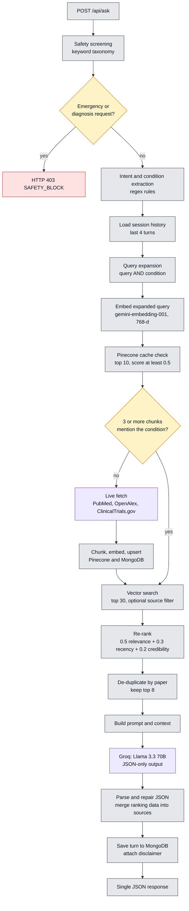
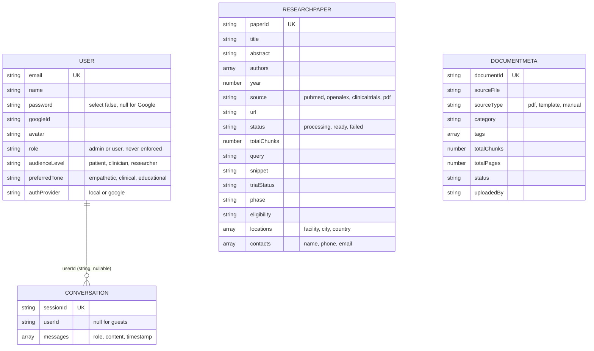

<div align="center">

# Curalink Backend

**Express API for a source-grounded medical research assistant: safety screening, live research retrieval, vector search, re-ranking and structured LLM answers.**

<p>
  
  
  
  
</p>
<p>
  
  
  
  
</p>

<a href="#architecture">Architecture</a> ·
<a href="#local-setup">Local Setup</a> ·
<a href="#api-reference">API</a> ·
<a href="#ranking-and-safety">Ranking and Safety</a> ·
<a href="#known-limitations">Limitations</a>

</div>

---

> [!IMPORTANT]
> Curalink is a research assistance tool, not a medical device. It does not diagnose, treat or advise. Always consult a qualified healthcare professional.

This repository is the **backend** of Curalink. It receives a question, screens it for safety, extracts the condition and intent, checks a Pinecone index for relevant evidence, ingests fresh papers and trials from **PubMed, OpenAlex and ClinicalTrials.gov** when coverage is thin, re-ranks the evidence, and asks **Llama 3.3 70B (Groq)** for a structured JSON answer grounded in the retrieved context.

The React client lives in the companion repository, [`curalink-frontend`](https://github.com/shafiqahmed-786/curalink-frontend). A system-level overview is in the main Curalink README.

## Table of Contents

- [Architecture](#architecture)
- [Ranking and Safety](#ranking-and-safety)
- [Technology Stack](#technology-stack)
- [Project Structure](#project-structure)
- [Local Setup](#local-setup)
- [Environment Variables](#environment-variables)
- [API Reference](#api-reference)
- [Data Models](#data-models)
- [Security](#security)
- [Deployment](#deployment)
- [Known Limitations](#known-limitations)
- [Contributing](#contributing)
- [License](#license)

---

## Architecture

Requests flow through a conventional layering: **routes → controllers → pipelines → services**, with `config/` holding third-party clients and `models/` holding Mongoose schemas.



| Stage | Behavior | Module |
|---|---|---|
| Safety | Substring match on `query`. `emergency` and `diagnosis` → 403. | `services/safety.service.js` |
| Intent | Regex: 8 intents, 3 timeframes, 76 condition terms. `disease` field overrides. History is scanned if no condition is found. | `services/intent.service.js` |
| Routing | Embeds `query AND condition`, counts condition-matching chunks among the top 10 (score ≥ 0.5). Fewer than 3 triggers a live fetch. Fetch errors are swallowed. | `services/queryRouter.service.js` |
| Retrieval | Pinecone `topK: 30`, no score floor, optional `source` metadata filter. | `services/retrieval.service.js` |
| Ranking | Composite score, then per-paper de-duplication, top 8. | `services/reranker.service.js`, `pipelines/rag.pipeline.js` |
| Prompting | Audience and tone variants, strict rules, JSON schema, context capped at `CONTEXT_MAX_TOKENS × 4` characters. | `utils/promptBuilder.js` |
| Generation | `llama-3.3-70b-versatile` through Groq's OpenAI-compatible API. Up to 3 retries on 429, 500, 502, 503 (3 s base, 15 s cap). | `services/llm.service.js` |
| Parsing | Strips code fences, repairs truncated JSON, falls back to raw text with `structured: false`. | `utils/responseParser.js` |
| Memory | Last `MAX_CONVERSATION_HISTORY × 2` messages per `sessionId`. | `services/conversation.service.js` |

There is **no streaming**: `/api/ask` returns one JSON body after the pipeline completes.

---

## Ranking and Safety

### Re-ranking

```text
rankingScore = 0.5 × relevance + 0.3 × recency + 0.2 × credibility

relevance   = Pinecone similarity score, clamped to [0, 1]
recency     = (year − 2000) / (currentYear − 2000), clamped to [0, 1];  0.3 if year unknown
credibility = pubmed 1.0 · openalex 0.85 · clinicaltrials 0.75 · pdf 0.6 · anything else 0.5
```

Each returned source carries `rankingScore` and `rankingBreakdown { relevance, recency, credibility }`, which the frontend shows as "Why ranked #N?".

### Safety taxonomy

Case-insensitive substring match on the `query` field. The first matching group wins, in the order shown.

| Group | Severity | Example triggers | Behavior |
|---|---|---|---|
| `emergency` | CRITICAL | heart attack, overdose, suicidal, stroke, chest pain | **403 `SAFETY_BLOCK`** with `emergencyResource` |
| `diagnosis` | HIGH | "do i have", "diagnose me", "is this cancer" | **403 `SAFETY_BLOCK`** |
| `prescription` | HIGH | "what dosage", "can i take", "prescribe me" | Allowed, educational disclaimer |
| `sensitive` | MEDIUM | depression, HIV, addiction, anorexia | Allowed, sensitive-topic disclaimer |
| none | none | everything else | Allowed, general disclaimer |

The system prompt additionally instructs the model to never diagnose, never recommend specific medications or dosages, to hedge, to recommend consulting a professional, and to answer only from the supplied context.

---

## Technology Stack

| Layer | Technology | Purpose |
|---|---|---|
| Runtime | Node.js 20.19+ / 22.12+ | Server runtime (minimum comes from Mongoose 9, `pdf-parse` 2.4 and their lockfile `engines`) |
| Framework | Express 5.2 | HTTP API |
| Language | JavaScript (CommonJS) | Application code |
| LLM | Llama 3.3 70B Versatile on Groq (`openai` SDK) | Answer generation |
| Embeddings | `gemini-embedding-001`, 768-d (`@google/genai`) | Semantic vectors |
| Vector database | Pinecone (`@pinecone-database/pinecone` 7) | Similarity search |
| Database | MongoDB, Mongoose 9 | Users, conversations, metadata |
| Authentication | `jsonwebtoken`, `bcryptjs`, `passport-google-oauth20` | JWT and Google OAuth |
| Security | Helmet, CORS, `express-rate-limit` | Headers, origins, throttling |
| Uploads | Multer (memory storage), `pdf-parse` 2 | PDF intake and text extraction |
| Logging | Winston | Console logs |
| Research APIs | PubMed E-utilities, OpenAlex, ClinicalTrials.gov v2 | Literature and trials |
| Dev tooling | nodemon | Reload during development |

`joi` and `supertest` are listed in `package.json` but are not used anywhere in the code.

---

## Project Structure

```text
curalink-backend/
├── server.js                     # Load env, connect MongoDB, start HTTP server
├── scripts/preload-demo.js       # Pre-ingest 4 demo queries (5 records per source)
├── .env.example
├── package.json
└── src/
    ├── app.js                    # helmet, cors, json, passport, requestId, rateLimiter, routes, 404, error handler
    ├── config/
    │   ├── db.js                 # Mongoose connection (exits process on failure)
    │   ├── pinecone.js           # Lazy Pinecone client and index
    │   ├── groq.js               # OpenAI SDK pointed at api.groq.com/openai/v1
    │   └── passport.js           # Google strategy, registered only if credentials exist
    ├── middleware/
    │   ├── auth.middleware.js    # protect (401 if no valid JWT), optionalAuth
    │   ├── rateLimiter.js
    │   ├── requestId.middleware.js
    │   └── errorHandler.js       # Maps SAFETY_BLOCK to 403, others to statusCode or 500
    ├── routes/                   # health, auth, ask, conversation, upload, research
    ├── controllers/              # ask, auth, upload, research
    ├── pipelines/
    │   ├── rag.pipeline.js
    │   ├── research.ingestion.pipeline.js
    │   └── ingestion.pipeline.js # PDF
    ├── services/                 # safety, intent, queryRouter, retrieval, reranker, llm,
    │                             # embedding, conversation, pubmed, openalex, clinicaltrials
    ├── models/                   # User, Conversation, ResearchPaper, DocumentMeta
    └── utils/                    # promptBuilder, responseParser, chunker, jwt, logger
```

---

## Local Setup

**Prerequisites:** Node.js 20.19+ or 22.12+; a MongoDB connection string; a Pinecone account with an index of **768 dimensions** (cosine recommended, default name `health-copilot`, the app does not create it); a Google AI Studio key; a Groq key.

```bash
git clone https://github.com/shafiqahmed-786/curalink-backend.git
cd curalink-backend
npm install
cp .env.example .env     # fill in values, see below
npm run dev              # nodemon server.js on http://localhost:3000
```

```bash
curl http://localhost:3000/api/health
```

Optional: pre-load demo evidence (lung cancer treatment, diabetes trials, Alzheimer's research, heart disease studies). It pauses 30 s between queries:

```bash
npm run preload-demo
```

| Script | Action |
|---|---|
| `npm run dev` | `nodemon server.js` |
| `npm start` | `node server.js` |
| `npm run preload-demo` | Run research ingestion for the 4 demo queries |

There are no lint or test scripts.

---

## Environment Variables

Placeholders only. Never commit real values. `.env` is git-ignored.

| Variable | Purpose | Required | Default / example |
|---|---|---|---|
| `MONGODB_URI` | MongoDB connection string | **Yes** | `mongodb+srv://<user>:<password>@cluster.mongodb.net/` |
| `MONGODB_DB_NAME` | Database name | No | `health_copilot` |
| `PINECONE_API_KEY` | Pinecone key | **Yes** | `your-pinecone-api-key-here` |
| `PINECONE_INDEX_NAME` | Index name | No | `health-copilot` |
| `GEMINI_API_KEY` | Google AI Studio key (**embeddings only**) | **Yes** | `your-google-ai-studio-key-here` |
| `GEMINI_EMBEDDING_MODEL` | Embedding model | Recommended | `gemini-embedding-001` |
| `GROQ_API_KEY` | Groq key (**generation**) | **Yes** | `your-groq-api-key-here` |
| `GROQ_MODEL` | Chat model | No | `llama-3.3-70b-versatile` |
| `GEMINI_MAX_TOKENS` | `max_tokens` for the Groq call | No | `1500` |
| `GEMINI_TEMPERATURE` | Temperature for the Groq call | No | `0.3` |
| `JWT_SECRET` | JWT signing secret | **Yes** | `a-long-random-string` |
| `JWT_EXPIRES_IN` | Token lifetime | No | `7d` |
| `GOOGLE_CLIENT_ID` / `GOOGLE_CLIENT_SECRET` | Enable Google sign-in | No | `your-google-client-id` / `your-google-client-secret` |
| `GOOGLE_CALLBACK_URL` | OAuth redirect URI | No | `http://localhost:3000/api/auth/google/callback` |
| `FRONTEND_URL` | CORS origin and post-login redirect | No | `http://localhost:5173` |
| `PORT` | HTTP port | No | `3000` |
| `NODE_ENV` | Logged at startup | No | `development` |
| `LOG_LEVEL` | Winston level | No | `info` |
| `RATE_LIMIT_WINDOW_MS` / `RATE_LIMIT_MAX_REQUESTS` | Throttle window and cap per IP | No | `900000` / `100` |
| `UPLOAD_MAX_FILE_SIZE_MB` | PDF size limit | No | `20` |
| `CHUNK_SIZE_TOKENS` / `CHUNK_OVERLAP_TOKENS` | Chunking | No | `500` / `50` |
| `CONTEXT_MAX_TOKENS` | Prompt context budget (× 4 chars) | No | `3000` |
| `MAX_CONVERSATION_HISTORY` | Turns of history to the LLM | No | `4` |
| `FRESH_FETCH_THRESHOLD` | Relevant chunks needed to skip live fetch | No | `3` |
| `MIN_RETRIEVAL_SCORE` | Score floor for the cache check | No | `0.5` |
| `MAX_PAPERS_PER_SOURCE` | Records per source on live fetch | No | `50` |
| `PINECONE_TOP_K` | Default top-k | No | `30` |
| `OPENALEX_EMAIL` | OpenAlex polite-pool contact | No | `your-email@example.com` |
| `PUBMED_API_KEY` | NCBI API key. **Used by code, absent from `.env.example`** | No | `your-ncbi-api-key` |

**Caveats**

- Unset `JWT_SECRET` falls back to a hard-coded development secret in `utils/jwt.js`.
- Unset `GEMINI_EMBEDDING_MODEL` falls back to `text-embedding-004` in code (while `/api/research/stats` reports `gemini-embedding-001`). Index and queries must use the same model.
- `PINECONE_TOP_K` has no effect today: both call sites pass an explicit `topK`.
- `GEMINI_BASE_URL`, `GEMINI_CHAT_MODEL` and `UPLOAD_TEMP_DIR` are in `.env.example` but never read.
- Values such as `0` for `GEMINI_TEMPERATURE` or `MIN_RETRIEVAL_SCORE` are replaced by the default, because the code uses `|| default`.

---

## API Reference

Base path `/api`. Errors: `{ "success": false, "error": "CODE", "message": "..." }`. Authenticated routes need `Authorization: Bearer <token>`.

| Method | Endpoint | Purpose | Authentication |
|---|---|---|---|
| `GET` | `/api/health` | `{ status, mongodb, pinecone, uptime, timestamp }` | None |
| `POST` | `/api/auth/signup` | Create account → `201 { token, user }` | None |
| `POST` | `/api/auth/login` | Login → `{ token, user }`. `400 WRONG_AUTH_METHOD` for Google accounts | None |
| `GET` | `/api/auth/me` | Current user | Required |
| `PATCH` | `/api/auth/me` | Update `name`, `audienceLevel`, `preferredTone` | Required |
| `GET` | `/api/auth/google` | Begin Google OAuth (`501 NOT_CONFIGURED` without credentials) | None |
| `GET` | `/api/auth/google/callback` | Redirect to `FRONTEND_URL/auth/callback?token=<jwt>` | None |
| `GET` | `/api/auth/google/failed` | `401 GOOGLE_AUTH_FAILED` | None |
| `POST` | `/api/ask` | Run the RAG pipeline | Optional |
| `GET` | `/api/conversations` | User's last 50 sessions (first message only) | Required |
| `GET` | `/api/conversations/:sessionId` | Full conversation | Optional |
| `DELETE` | `/api/conversations/:sessionId` | Delete own conversation | Required |
| `POST` | `/api/upload` | Index a PDF (`multipart/form-data`, field `file`; optional `category`, `tags`, `userId`) | None |
| `GET` | `/api/documents` | List indexed PDFs | None |
| `DELETE` | `/api/documents/:documentId` | Delete a PDF's vectors and metadata | None |
| `POST` | `/api/research/ingest` | `{ query, sources?, maxPerSource? }`, defaults `["pubmed","openalex"]` and `10` | None |
| `GET` | `/api/research/papers` | Query params `source`, `query` (regex, case-insensitive), `limit` (20) | None |
| `GET` | `/api/research/stats` | `{ totalPapers, bySource, vectorStore, llmModel, embeddingModel }` | None |

### `POST /api/ask`

| Field | Notes |
|---|---|
| `query` | Required unless `additionalQuery` or `disease` is provided (else `400 VALIDATION_ERROR`) |
| `sessionId` | Omit for a new session; the response returns the ID |
| `disease` | Overrides extracted condition; used in query expansion |
| `patientName`, `location` | Passed to the model as prompt context |
| `source` | `pubmed`, `openalex`, `clinicaltrials`, `pdf` or `Uploaded PDFs` (metadata filter on `source`) |
| `audienceLevel` | `patient` (default), `clinician`, `researcher` |
| `preferredTone` | `educational` (default), `clinical`, `empathetic` |
| `displayText` | Stored as the user message in history |

```json
{ "query": "Clinical trials for diabetes", "sessionId": "<optional uuid>" }
```

Response shape (values illustrative):

```json
{
  "success": true,
  "data": {
    "intent": "clinical_trials",
    "condition": "diabetes",
    "timeframe": null,
    "expandedQuery": "Clinical trials for diabetes",
    "freshFetch": true,
    "fetchedFrom": ["pubmed", "openalex", "clinicaltrials"],
    "structured": true,
    "audienceLevel": "patient",
    "sessionId": "<uuid>",
    "conditionOverview": "...",
    "researchInsights": [{ "finding": "...", "source": "..." }],
    "clinicalTrials": [{ "title": "...", "status": "...", "phase": "...", "eligibility": "...",
                         "locations": [{ "facility": "...", "city": "...", "country": "..." }],
                         "contacts": [{ "name": "...", "phone": "...", "email": "..." }],
                         "url": "https://clinicaltrials.gov/study/NCT..." }],
    "experts": [{ "name": "...", "affiliation": "...", "contribution": "..." }],
    "sources": [{ "title": "...", "authors": ["..."], "year": 2025, "platform": "clinicaltrials",
                  "url": "...", "snippet": "...", "rankingScore": 0.78,
                  "rankingBreakdown": { "relevance": 0.6, "recency": 0.9, "credibility": 0.75 } }],
    "disclaimers": ["ℹ️ This content is for informational purposes only and should not replace professional medical advice."],
    "usage": { "promptTokens": 0, "completionTokens": 0 }
  }
}
```

If the model's output is not valid JSON, `structured` is `false` and the raw text is returned in `conditionOverview`.

Safety block (403):

```json
{ "success": false, "error": "SAFETY_BLOCK", "triggerType": "emergency",
  "message": "This appears to be a medical emergency. Please call emergency services immediately.",
  "emergencyResource": "Emergency: 112 (India) · 911 (US)" }
```

---

## Data Models



**Pinecone records.** IDs are `<paperId>_chunk_<n>` (research) or `<documentId>_chunk_<n>` (PDF). Research metadata: `paperId, title, authors (joined), year, source, url, snippet, chunkIndex, text, query, trialStatus, phase, eligibility, locations (JSON string), contacts (JSON string)`. PDF metadata: `documentId, sourceFile, category, chunkIndex, text, pageNumber (always 0)`. **PDF vectors have no `source` field.**

---

## Security

**Implemented:** Helmet, CORS allow-list, per-IP rate limiting, per-request `X-Request-ID`, bcrypt (cost 12), JWT auth with `protect` / `optionalAuth`, user-scoped conversation list and delete, PDF-only and size-limited uploads in memory, secrets from environment, structured error responses without stack traces, keyword safety screening and disclaimers.

**Not implemented (current gaps):**

- `/api/upload`, `/api/documents`, `/api/research/ingest`, `/api/research/papers` and `/api/research/stats` are **unauthenticated**. Ingest triggers paid embedding calls, and the `role` field is never checked.
- Uploaded PDFs go into the shared index and are retrievable by any user's query.
- Guest conversations are persisted with `userId: null`; `GET /api/conversations/:sessionId` does not check ownership. A `userId` in the `/ask` body is trusted when no token is sent.
- `joi` is installed but unused. There is no schema validation or query-length cap, and the minimum password length is 6.
- `GET /api/research/papers` passes the `query` parameter into a MongoDB `$regex` unescaped.
- `trust proxy` is not configured, which affects per-IP rate limiting behind a proxy.
- JWTs are handed to the browser in a URL query string after Google sign-in.
- Substring safety matching can over-block (a research question about *stroke* is refused as an emergency) and under-block, and it does not inspect the `disease` field.

**Data sent to third parties:** query text to Google (embeddings) and Groq (generation, along with any patient name and location); the expanded query to PubMed, OpenAlex and ClinicalTrials.gov. Uploaded PDF text is stored in Pinecone metadata.

---

## Deployment

There is no Dockerfile, Procfile or platform configuration in this repository. It runs as a plain Node process:

```bash
npm install --omit=dev
npm start
```

Checklist for production:

- Set all required variables, and always set `JWT_SECRET`.
- `FRONTEND_URL` must equal the deployed frontend origin (CORS and OAuth redirect).
- `GOOGLE_CALLBACK_URL` must be the deployed backend callback URL, registered in Google Cloud.
- The first question on a new topic runs a synchronous live fetch and embedding of up to `MAX_PAPERS_PER_SOURCE` records per source. Make sure the host's request timeout exceeds the frontend's 120 s client timeout.
- Configure `trust proxy` behind a reverse proxy.

No live deployment URL is documented in the repository.

---

## Known Limitations

- **Profile settings are not applied.** `audienceLevel` and `preferredTone` come only from the `/ask` request body. The stored user preferences are never read in the ask path, and the web client does not send them.
- **Uploaded-PDF filter returns nothing.** The `Uploaded PDFs` / `pdf` source filter matches `source == pdf`, which PDF vectors do not have. PDF chunks also score credibility 0.5 (not 0.6) and are de-duplicated to one chunk per file.
- **No abstention.** With zero retrieved chunks, the LLM is still called without context.
- **Heuristic NLP.** Fixed condition list, concatenation-based expansion, regex intents.
- **Whole question sent to every source**, including ClinicalTrials.gov `query.cond`, which may reduce recall.
- **PubMed abstract parsing** is regex-based and keeps only the first section. A record without an abstract can pick up the next record's abstract.
- **Source attribution** falls back to list position when URL and title matching fail.
- **Synchronous live fetch** can make the first query on a new topic slow.
- **No tests, no CI.**

## Contributing

1. Fork this repository and create a branch (`feat/...`, `fix/...`, `docs/...`).
2. Run it locally with your own keys. Never commit `.env`.
3. Keep changes focused and in the existing CommonJS / Express style.
4. Use [Conventional Commits](https://www.conventionalcommits.org/).
5. There is no automated suite yet, so describe how you verified the change and include request/response examples for API changes. New tests are welcome (`supertest` is already a dev dependency).
6. Open a pull request, and link the companion frontend change if the API contract changes.

## License

`package.json` declares **ISC**. The repository does not include a `LICENSE` file.

## Acknowledgements

PubMed / NCBI E-utilities, OpenAlex, ClinicalTrials.gov, Groq, Meta Llama, Google Gemini API, Pinecone, MongoDB, and the Express, Mongoose, Passport, Helmet, Multer, `pdf-parse` and Winston projects.
