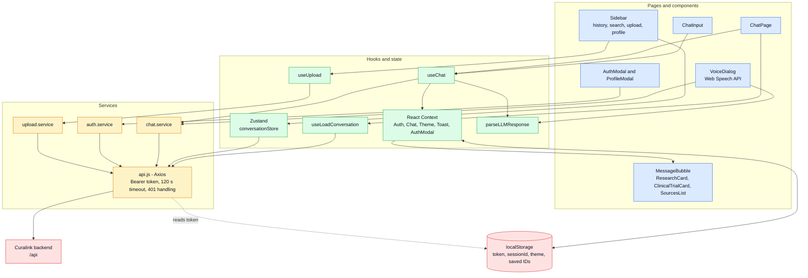

<div align="center">

# Curalink Frontend

**React single-page app for a source-grounded medical research assistant: chat, ranked evidence cards, clinical-trial details, voice mode and conversation history.**

<p>
  
  
  
  
</p>
<p>
  
  
  
  
</p>

<a href="#architecture">Architecture</a> ·
<a href="#local-setup">Local Setup</a> ·
<a href="#how-responses-are-rendered">Rendering</a> ·
<a href="#voice-mode">Voice Mode</a> ·
<a href="#known-limitations">Limitations</a>

</div>

---

> [!IMPORTANT]
> Curalink is a research assistance tool, not a medical device. It does not diagnose, treat or advise. Always consult a qualified healthcare professional.

This repository is the **frontend** of Curalink. It sends questions to the Curalink API and renders the structured result: a plain-language overview, research insights, paper cards with a "Why ranked #N?" breakdown, clinical-trial cards (status, phase, locations, contacts), key researchers and a source list. It also provides sign-in, a conversation sidebar, PDF upload, light/dark themes and a browser-based voice mode.

The API lives in [`curalink-backend`](https://github.com/shafiqahmed-786/curalink-backend). A system-level overview, including the RAG pipeline, is in the main Curalink README.

## Table of Contents

- [Features](#features)
- [Architecture](#architecture)
- [Routes](#routes)
- [How Responses Are Rendered](#how-responses-are-rendered)
- [Voice Mode](#voice-mode)
- [Technology Stack](#technology-stack)
- [Project Structure](#project-structure)
- [Local Setup](#local-setup)
- [Environment Variables](#environment-variables)
- [Backend Endpoints Used](#backend-endpoints-used)
- [Browser Storage](#browser-storage)
- [Deployment](#deployment)
- [Known Limitations](#known-limitations)
- [Contributing](#contributing)
- [License](#license)

---

## Features

| Feature | Details |
|---|---|
| **Research chat** | Idle welcome screen with four suggested queries, then an active thread. Typing indicator while waiting. One automatic retry (after 1.5 s) on network errors or HTTP 5xx, plus a manual **Retry** button on failed turns. |
| **Structured query mode** | A *Structured* toggle reveals *Disease / Condition*, *Patient Name* and *Location* fields, sent with the question. |
| **Source filter** | A selector offers *All Sources* and *Uploaded PDFs*. |
| **Evidence cards** | Research papers, clinical trials, key researchers and a collapsible source list, each with source badges. Paper cards expose a ranking breakdown. |
| **Authentication** | Email/password and Google OAuth through a modal. Guests can chat without an account. Session restore on reload by validating the stored token. |
| **Conversation history** | For signed-in users: sidebar grouped by Today / Yesterday / Previous 7 days / Previous 30 days / month, with title search, delete (calls the API), plus rename and save/pin (browser-only). |
| **PDF upload** | Drag-and-drop modal with progress, reachable from the sidebar for signed-in users. |
| **Profile settings** | Name, audience level and response style. See [limitations](#known-limitations). |
| **Voice mode** | Speech-to-text and text-to-speech through the Web Speech API. |
| **Theming and responsiveness** | Light/dark themes (stored choice, falling back to OS preference). At ≤ 768 px the sidebar becomes a slide-over drawer. |
| **Resilience** | Error boundaries around the app and each message, toasts, and a spinner while the stored token is validated. |

---

## Architecture



**Provider tree** (`main.jsx`), outermost first: `BrowserRouter` → `ThemeProvider` → `AuthProvider` → `ToastProvider` → `AuthModalProvider` → `ChatProvider` → `App`. `ToastProvider` must wrap `AuthModalProvider` because the modal uses toasts.

**State split.** Auth, chat messages, theme, toasts and the auth modal use React Context. The conversation list, saved IDs and active session use a Zustand store, because both the sidebar and the chat page read and mutate them.

**Message lifecycle.** `useChat.sendMessage` appends the user message, calls `POST /ask`, runs the payload through `parseLLMResponse`, merges ranking data into sources, stores the returned `sessionId` (persisted only for signed-in users), and appends the assistant message. The backend returns the whole answer at once, so there is **no streaming** in the UI. The typing indicator is shown until the response arrives.

---

## Routes

| Path | Component | Notes |
|---|---|---|
| `/` | Redirect to `/chat` | |
| `/chat` | `ChatPage` | New conversation |
| `/chat/:sessionId` | `ChatPage` | Loads a past conversation (signed-in users) |
| `/login`, `/register` | `LoginPage`, `RegisterPage` | Redirect to `/chat` and open the auth modal |
| `/auth/callback` | `AuthCallbackPage` | Reads `?token=`, validates it with `GET /auth/me`, then signs in |
| `*` | `NotFoundPage` | |

---

## How Responses Are Rendered

`MessageBubble` maps the API payload to UI sections:

| API field | UI |
|---|---|
| `conditionOverview` | Answer paragraph |
| `disclaimers[0]` | Informational banner (`SafetyBanner`, low severity) |
| counts of papers, trials, experts, sources | Stats bar |
| `researchInsights[]` (`finding`, `source`) | **Research Insights** list |
| `sources[]` where `platform` is not `clinicaltrials` | **Research Papers**: `ResearchCard` with source badge, year, snippet or abstract toggle, copy-link, and the **"Why ranked #N?"** breakdown (`rankingScore`, relevance / recency / credibility) |
| `clinicalTrials[]` | **Clinical Trials**: `ClinicalTrialCard` with status badge, phase, eligibility excerpt, locations, contacts and a link to ClinicalTrials.gov |
| `experts[]` | **Key Researchers** |
| `sources[]` | Collapsible **All Sources** list |
| `freshFetch` | Note that live data was fetched from PubMed, OpenAlex and ClinicalTrials.gov |

`parseLLMResponse` makes the UI tolerant of model output that arrives as fenced JSON, truncated JSON or plain text. It is applied both to live answers and to conversations reloaded from history.

---

## Voice Mode

Opened from the microphone button in the chat input (`VoiceDialog.jsx`).

- **Speech to text:** `SpeechRecognition` / `webkitSpeechRecognition`, language `en-US`, single utterance with interim results, auto-submitted when speech ends. Unsupported browsers show a message recommending Chrome.
- **Answering:** the transcript is sent to the same `POST /ask` endpoint, using a temporary session ID of the form `voice-<uuid>`, and the answer's overview text is shown.
- **Text to speech:** `speechSynthesis`, preferring a "Google US English" voice when present, with basic Markdown characters stripped.
- **Cleanup:** when the dialog closes, signed-in users' temporary voice session is deleted through `DELETE /conversations/:id`.
- **Third-party content:** the dialog loads an animated background from `my.spline.design` in an iframe about one second after opening. Speech processing is performed by the browser's own implementation.

---

## Technology Stack

| Layer | Technology | Purpose |
|---|---|---|
| Framework | React 19, Vite 8 | UI and build |
| Language | JavaScript (ES modules, JSX) | No TypeScript |
| Routing | React Router 6.28 | Client-side routes |
| State | Zustand 4.5, React Context | Conversations; auth, chat, theme, toasts |
| HTTP | Axios 1.7 | API client with interceptors |
| Styling | CSS Modules, CSS custom properties | Scoped styles and theme tokens (no Tailwind) |
| Fonts | Inter via Google Fonts | Loaded from `index.html` |
| Charts | Recharts 3.8 | Trend chart (dormant, see limitations) |
| Icons | Inline SVG, `react-icons` | `react-icons` is used only in `VoiceDialog` |
| Linting | ESLint 9 with react-hooks and react-refresh plugins | `npm run lint` |
| Deployment | Vercel configuration | SPA rewrite |

`@tanstack/react-virtual` is listed in `package.json` but is not imported anywhere.

---

## Project Structure

```text
curalink-frontend/
├── index.html                    # Vite entry; Inter font link
├── vite.config.js                # React plugin only
├── vercel.json                   # Rewrite /(.*) -> /index.html
├── eslint.config.js
├── SYSTEM_DOCUMENTATION.md       # Earlier internal notes (partly outdated)
├── test_parse.js / test_parse.mjs# Ad-hoc parser scripts, not a test suite
├── public/                       # favicon.svg, icons.svg, fire-flame-curved.png
└── src/
    ├── main.jsx                  # Providers and mount
    ├── App.jsx                   # Route table, token-restore spinner, error boundary
    ├── index.css                 # Design tokens for light and dark themes
    ├── pages/                    # ChatPage, LoginPage, RegisterPage, AuthCallbackPage, NotFoundPage
    ├── components/
    │   ├── chat/                 # ChatInput, MessageBubble, WelcomeScreen, TypingIndicator, VoiceDialog
    │   ├── research/             # ResearchCard, ClinicalTrialCard, SourcesList, SafetyBanner, ResearchTrendChart
    │   ├── layout/               # Header, MainLayout, Sidebar, sidebar/*
    │   ├── auth/ profile/ upload/ common/
    ├── context/                  # Auth, AuthModal, Chat, Theme, Toast
    ├── hooks/                    # useChat, useLoadConversation, useUpload, useAuth, useTheme, useIsMobile
    ├── services/                 # api.js, auth, chat, upload, research
    ├── store/conversationStore.js
    └── utils/                    # parseLLMResponse, constants, formatters, groupConversations, storage
```

---

## Local Setup

**Prerequisites:** Node.js **20.19+ or 22.12+** (Vite 8's requirement) and a running [Curalink backend](https://github.com/shafiqahmed-786/curalink-backend).

```bash
git clone https://github.com/shafiqahmed-786/curalink-frontend.git
cd curalink-frontend
npm install
echo "VITE_API_URL=http://localhost:3000/api" > .env
npm run dev          # http://localhost:5173
```

| Command | Action |
|---|---|
| `npm run dev` | Vite dev server with HMR |
| `npm run build` | Production build to `dist/` |
| `npm run preview` | Serve the production build locally |
| `npm run lint` | Run ESLint |

The backend's CORS allow-list includes `FRONTEND_URL` (default `http://localhost:5173`) and ports 5174 and 5175, so the dev server works on those ports without extra configuration.

---

## Environment Variables

`.env` and `.env.*` are git-ignored. There is no committed `.env.example`; create `.env` yourself. Vite inlines these values at build time.

| Variable | Purpose | Required | Default / example |
|---|---|---|---|
| `VITE_API_URL` | Backend base URL, **ending in `/api`**. Also used to build the Google sign-in link (`<origin>/api/auth/google`). | Dev: no. Production build: **yes** | `http://localhost:3000/api` |
| `VITE_MAX_PDF_MB` | Size shown in the upload hint. Display only, it does not enforce a limit. | No | `20` |

---

## Backend Endpoints Used

| Call | Purpose |
|---|---|
| `POST /ask` | Questions (chat and voice) |
| `GET /conversations` | Sidebar history |
| `GET /conversations/:sessionId` | Reload a past conversation |
| `DELETE /conversations/:sessionId` | Delete a conversation (and clean up voice sessions) |
| `POST /auth/signup`, `POST /auth/login` | Email/password auth |
| `GET /auth/me`, `PATCH /auth/me` | Restore session; save profile |
| `GET /auth/google` | Full-page navigation to start Google sign-in |
| `POST /upload` | PDF upload (multipart, field `file`) |

`research.service.js` defines wrappers for `/research/ingest`, `/research/papers` and `/research/stats`, but nothing in the UI calls them. The Axios client sends `Authorization: Bearer <token>` when a token is stored. A 401 on a non-`/auth/` request with a stored token clears it and redirects to `/login`.

---

## Browser Storage

| Key | Contents |
|---|---|
| `token` | JWT |
| `sessionId` | Current conversation ID (signed-in users only) |
| `theme` | `light` or `dark` |
| `curalink_saved_ids` | IDs of conversations the user has saved/pinned (cleared on logout) |

The JWT is kept in `localStorage`, which is readable by any script running on the page.

---

## Deployment

`vercel.json` rewrites all paths to `/index.html`, which lets client-side routes such as `/chat/:sessionId` survive a refresh. Build with `npm run build` and serve `dist/` from Vercel or any static host.

Before building, set `VITE_API_URL` to the deployed backend URL (ending in `/api`). On the backend, set `FRONTEND_URL` to this app's origin so CORS and the Google OAuth redirect work. The Axios timeout is 120 s, since the first question on a new topic can trigger a slow live fetch on the server. No live deployment URL is documented in the repository.

---

## Known Limitations

- **Profile preferences are not sent with questions.** The profile dialog saves audience level and response style to the user record, but `chat.service` never forwards them and the API does not read them in `/ask`, so answers use the defaults. The dialog's *Simplified* style is also not one of the backend's allowed tone values (`empathetic`, `clinical`, `educational`).
- **"Uploaded PDFs" filter.** It depends on a backend metadata field that PDF vectors do not carry, so selecting it currently returns no PDF evidence.
- **Guest banner.** The UI says "This chat won't be saved" to guests, but the backend does save guest turns (without a user ID).
- **Dormant sections.** The research-intensity trend chart, "Key Takeaways", "Questions for your doctor", the trial-eligibility summary and the safety-severity banner read fields (`stats`, `patientTakeaways`, `suggestedQuestions`, `trialEligibilitySummary`, `safetyMessage`) that the current backend does not return.
- **Local-only state.** Conversation rename and save/pin never reach the server.
- **No streaming**, and voice mode is `en-US` only and needs browser Web Speech support.
- `index.html` still has the title `ai-health-copilot-frontend`, and `package.json` uses the same legacy name.
- No automated tests; `test_parse.*` are manual scripts.

---

## Contributing

1. Fork and create a branch (`feat/...`, `fix/...`, `docs/...`).
2. Run the backend locally, set `VITE_API_URL`, and exercise the flow you changed in the browser.
3. Follow the existing patterns: function components with hooks, CSS Modules per component, shared tokens in `index.css`.
4. Run `npm run lint` before committing.
5. Use [Conventional Commits](https://www.conventionalcommits.org/).
6. Open a pull request describing the change, with screenshots for UI work, and link any companion backend change.

## License

This package is marked `private` and has no license field, and the repository has no `LICENSE` file. The backend declares ISC in its `package.json`. Add a license file before inviting reuse.

## Acknowledgements

React, Vite, React Router, Zustand, Axios, Recharts and `react-icons`; Inter by Rasmus Andersson via Google Fonts; the Web Speech API implementations in modern browsers.
